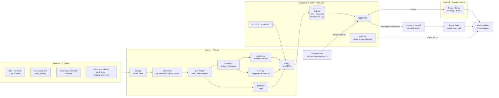
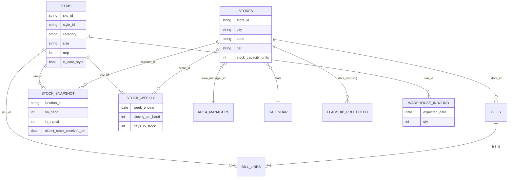
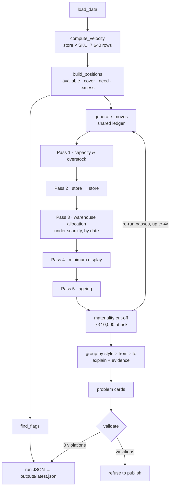
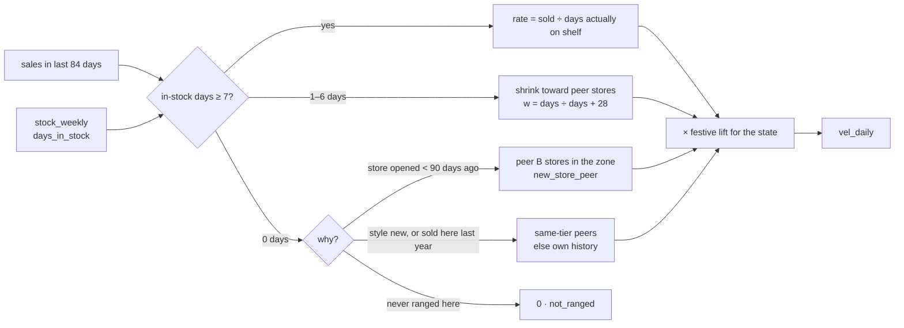
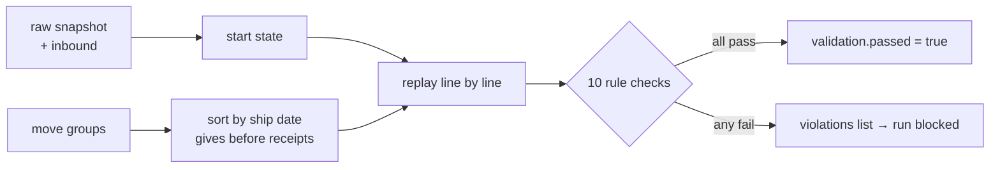
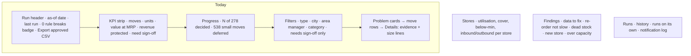
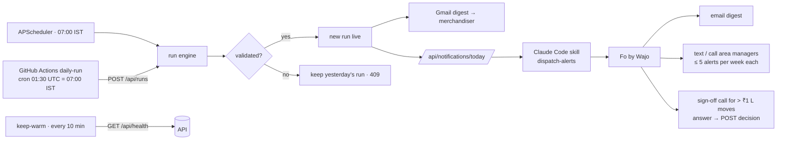
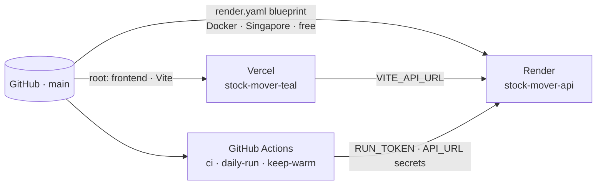

# Stock Mover

**Right stock. Right store. Right size.**
Manyavar (Vedant Fashions Ltd) × Calcutta AI Club · Vibe Coders Hackathon Edition 3 · Problem B

Every morning Stock Mover reads Manyavar's sales and stock, finds stock that is in the wrong place, and hands the
merchandiser a ranked, **ready-to-approve list** of warehouse sends, store-to-store moves and pull-backs. Each move is
explained in one line, checked against every rule, and delivered to the people who act on it.

| | |
|---|---|
| **Live app** | https://stock-mover-teal.vercel.app |
| **API** | https://stock-mover-api.onrender.com/api/health |
| **Design spec** | [docs/superpowers/specs/2026-11-21-stock-mover-design.md](docs/superpowers/specs/2026-11-21-stock-mover-design.md) |
| **Interfaces** | [contracts/CONTRACTS.md](contracts/CONTRACTS.md) |
| **Demo script** | [docs/demo-script.md](docs/demo-script.md) |

---

## Contents

1. [The problem](#1-the-problem)
2. [What today's run finds](#2-what-todays-run-finds)
3. [System architecture](#3-system-architecture)
4. [The data](#4-the-data)
5. [The engine, stage by stage](#5-the-engine-stage-by-stage)
6. [The rules and how they are enforced](#6-the-rules-and-how-they-are-enforced)
7. [Problem cards: a list you can approve in ten minutes](#7-problem-cards-a-list-you-can-approve-in-ten-minutes)
8. [Findings that are not moves](#8-findings-that-are-not-moves)
9. [Backend API](#9-backend-api)
10. [Frontend: the approval console](#10-frontend-the-approval-console)
11. [Runs on its own: scheduling and notifications](#11-runs-on-its-own-scheduling-and-notifications)
12. [Testing and the planted-problem gate](#12-testing-and-the-planted-problem-gate)
13. [Run it yourself](#13-run-it-yourself)
14. [Deploy](#14-deploy)
15. [Repository layout](#15-repository-layout)
16. [Design decisions and their trade-offs](#16-design-decisions-and-their-trade-offs)
17. [Known limitations](#17-known-limitations)
18. [How it was built](#18-how-it-was-built)

---

## 1. The problem

Manyavar runs 20 stores in six cities across Uttar Pradesh, Bihar and Karnataka, fed by one warehouse in Kolkata
(`WH-KOL`). Today the company tops stores up every Monday. The brief asks for a system that, **every day**, finds stock
in the wrong place and produces a list a merchandiser can approve in ten minutes, covering four cases:

| # | Case | The question |
|---|---|---|
| 1 | **Warehouse → store** | What to send, and to whom, when there isn't enough for everyone? |
| 2 | **Under-stocked stores** | Which stores would sell more if they held more? |
| 3 | **Store → store** | What should move from where it sits to where it sells? |
| 4 | **Ageing stock** | What should move to where it sells before it's too late? |

"Today" in the data is the close of **31 October 2026**. Diwali falls on **8 November**, Chhath on 15 November (Bihar),
and the wedding season runs **20 November – 12 December**. So the next 30 days are the busiest of the year, and
getting velocity right matters more than anything else.

The judges check four things: did the system find the planted problems, are the numbers right, is any rule broken,
and does it run on its own. The brief adds one warning: *"A product with zero sales isn't always a slow product."*

---

## 2. What today's run finds

| | |
|---|---|
| Moves to approve | **278** style-level groups (583 SKU lines, 2,014 units, ₹1.78 Cr at MRP) in **25 problem cards** |
| Rule breaks | **0**. An independent validator replays every move, and the run refuses to publish if it finds any |
| Revenue protected | **₹89 L** of festive-season sales that stores would otherwise miss |
| Need sign-off | **21** moves worth more than ₹1 lakh at MRP |
| Held back | **538** small moves (< ₹10,000 at risk, ₹15.3 L in total) deferred to tomorrow. Today's list keeps **88%** of the value |
| Findings | 38 flags: 19 data-quality, 12 re-order, 5 dead-stock, 1 capacity, 1 new store |

### The stock problems it surfaces

| Problem | Evidence in the data | What Stock Mover does |
|---|---|---|
| **KNP-03 is at 208% of capacity** | 300 × SHW-02-L arrived 3 Sep in a 250-unit B store that sold 1 of them in a year; the whole chain sells ~40 in 90 days | Releases 270 units: 212 back to the warehouse, 35 to stores that need them. KNP-03 receives nothing |
| **New launch KUR-04 missing at the flagship** | Launched 20 Sep, selling 62/day chain-wide, but LKO-01 (S++) and MZF-01 hold none | 128 units to LKO-01, 26 to MZF-01, 252 across 13 stores |
| **KUR-01 bestseller short for November** | Stores hold 0–8 per size; 648 units of supply for 1,097 units of need | Every selling store gets a presentation minimum first; the rest goes by need × velocity |
| **MZF-01 is starved** | 128 units in a 350-unit store (37%), 29 days of cover, Mojari 5 vs a minimum of 8 | A dedicated top-up card |
| **Zero sales ≠ slow** | KUR-12/15/18/24, MOJ-03/06, JKT-06, STL-03 sold hundreds of units and are now at zero everywhere with nothing inbound | Flagged **re-order**, never pulled back; stragglers consolidate to stores that sell them |
| **Genuinely dead stock** | JKT-08 (Neon Lime jacket) has been in stock at 15 locations for 12 weeks and sold 36 units ever | Flagged dead stock; aged units go to the few stores that sell them |
| **Ageing stock** | 1,458 units older than 180 days sit in stores (₹1.9 Cr at MRP) | Moved to stores that sell them before 12 Dec, or back to the warehouse |
| **BLR-05, brand-new store** | Opened 10 Oct with 3 weeks of history; Sherwani 2 vs a minimum of 5 | Velocity borrowed from peer B stores; minimum display filled |
| **Data that can't be trusted** | MYS-02 KUR-02-M shows **−4** on hand; 191 units sold in weeks recorded as 0 days in stock | Treated as 0 and flagged for a stock count; weekly in-stock days used as a weight, not gospel |

---

## 3. System architecture



The system has four parts:

- **The engine** is a pure-Python package with no web dependencies. `python -m engine.run` reads the CSVs and writes
  one JSON document, the *run*, in about 12 seconds. It is deterministic: the same data gives the same moves.
- **The backend** runs the engine on a schedule and on demand. It keeps the last *passing* run live, stores
  approve/reject decisions, exports the approved list and builds the notifications.
- **The frontend** is the merchandiser's approval console. If the API is asleep it falls back to a bundled snapshot of
  the latest run, so the link never looks broken.
- **Delivery** goes through Gmail (automatic, from the backend) and Fo by Wajo (via a Claude Code skill and the
  `wajo-fo` MCP server), which can email, text or phone people.

### One run, end to end

```mermaid
sequenceDiagram
    autonumber
    participant S as Scheduler / GitHub Action
    participant API as FastAPI
    participant ENG as Engine
    participant VAL as Validator
    participant DB as SQLite
    participant UI as Approval console
    participant M as Merchandiser
    participant FO as Fo (Wajo)

    S->>API: 07:00 IST or POST /api/runs (token)
    API->>ENG: run_engine(trigger)
    ENG->>ENG: load → velocity → positions → moves → explain → flags
    ENG->>VAL: validate(every move)
    alt any rule broken
        VAL-->>API: violations
        API-->>S: 409, previous run stays live
    else 0 violations
        VAL-->>ENG: passed
        ENG-->>API: run JSON
        API->>DB: save run
        API->>M: email digest (Gmail)
    end
    M->>UI: open live link
    UI->>API: GET /api/runs/latest
    M->>UI: Approve card / reject move
    UI->>API: POST /api/groups/{id}/decision
    M->>UI: Export approved CSV
    API-->>FO: /api/notifications/today (via Claude Code skill)
    FO-->>M: email, text or call; area managers get ≤ 5 alerts a week
```

---

## 4. The data

Seventeen CSV tables, the same data every team received. It is synthetic but tuned to real Manyavar patterns.



| Table | Rows | Used for |
|---|---|---|
| `stores` | 20 | Tier (S++, S+, A, B), city, zone, capacity |
| `items` | 385 | 382 products (24 Kurta Set, 12 Sherwani, 10 Indo-Western, 10 Jacket, 6 Mojari styles + accessories) plus 3 packaging rows |
| `bills`, `bill_lines` | 90,805 / 259,772 | Two years of sales, 1 Nov 2024 – 31 Oct 2026 |
| `stock_snapshot` | 3,547 | On hand, in transit and oldest-unit date for every store and the warehouse on 31 Oct |
| `stock_weekly` | 61,416 | Units and **days in stock** per store × SKU × week, last 12 weeks: the key to de-censoring demand |
| `warehouse_inbound` | 768 | Deliveries due 1 Nov – 16 Dec (19,526 units) |
| `calendar` | 2,373 | Festivals and wedding dates per state |
| `rules`, `min_display`, `lead_times`, `flagship_protected` | — | The stock rules |
| `area_managers` | 6 | Who looks after which stores, and **`max_alerts_per_week = 5`** |

**Data traps handled in [engine/data.py](engine/data.py):**

- Packaging (carry bags, covers at ₹0) is removed from all sales and stock math.
- Safa, Mala and Stole are separate categories in `items` but one "Accessories" group in `min_display`; they are summed.
- `lead_times` routes are sentences, so they are mapped from each store's zone and city instead of parsed.
- Negative stock is clipped to 0 for the math, and the raw value is kept so it can be flagged.
- IDs stay strings (`dtype=str`) so nothing becomes a number or a date.
- The as-of date is read from the snapshot, never hard-coded.

---

## 5. The engine, stage by stage



### 5.1 Velocity: the heart of it ([engine/velocity.py](engine/velocity.py))

Velocity is units sold per day for each store × SKU. Every later number (cover, need, excess, priority) is built on it,
so it is built carefully, in five steps.



1. **De-censoring.** Sales are divided by the days the SKU was actually on the shelf (from `stock_weekly.days_in_stock`),
   not by calendar days. A kurta that sold 3 in the 12 days it was in stock is a 0.25/day seller, not 3 ÷ 84 = 0.04/day.
   This is the answer to "zero sales isn't always slow". Because 191 units were sold in weeks marked 0 days in stock, a
   day with a sale always counts as an in-stock day.
2. **Shrinkage.** A SKU with only a few in-stock days is noisy, so it is blended with a prior: the rate of the same SKU
   at same-tier stores in the same zone. The weight is `in_stock_days ÷ (in_stock_days + 28)`. This is what makes the
   LKO-01 flagship (KUR-04 in stock for one day) look as under-served as it really is.
3. **Fallbacks for zero in-stock days.**
   - New store (BLR-05): peer B stores in the South.
   - A newly launched style, or one the store sold last year: same-tier peers, else the store's own history.
     This keeps sold-out bestsellers from reading as zero demand.
   - A style the store never carried: 0 (`not_ranged`), so peer demand doesn't spread to every store.
4. **Festive lift per state.** Last year's Diwali-to-weddings season (Diwali −10 days to +41 days) compared with this
   year's 84-day window, adjusted for the year-on-year off-season trend. Result: **Bihar 2.48×, Uttar Pradesh 2.34×,
   Karnataka 1.95×**, capped to 1.0–3.5.
5. **Sanity band.** The chain-wide forecast must land between 300 and 500 units a day. It lands at **491.8**.
   November 2025 ran at 434/day without Diwali in it; a plain 90-day average would have said ~163/day and under-sent by ~2.7×.

Every row carries a `basis` label (`instock`, `shrunk`, `peer`, `history`, `new_store_peer`, `not_ranged`) so you can
see where each number came from. Today: 3,494 instock · 1,911 not_ranged · 1,110 history · 449 peer · 382 new_store_peer · 294 shrunk.

### 5.2 Positions ([engine/position.py](engine/position.py))

For every store × SKU:

| Field | Definition |
|---|---|
| `available` | on hand (clipped at 0) **+ in transit**. Stock on its way counts as arriving and is never sent twice |
| `cover_days` | `available ÷ vel_daily` (∞ when velocity is 0) |
| `need_units` | units to reach `vel_daily × (lead time from WH + 7 review + 7 safety days)`, raised to fill any category below minimum display |
| `excess_units` | units above 30 days of cover; **0 for protected S++ styles**; trimmed so a giver never drops below minimum display |
| `age_days` | as-of date minus `oldest_stock_received_on` |

Target cover therefore differs by zone: 17 days in the East (3-day lead), 18 in the North (4), 20 in the South (6).
The warehouse is modelled as a **timeline**: on-hand today plus each inbound date (1, 3 and 16 Nov, 1 and 16 Dec),
so a send can only ship once the stock is physically there.

### 5.3 Moves: one ledger, five passes ([engine/moves.py](engine/moves.py))

All passes read and write a single **ledger** of projected stock per location × SKU, per store total and per warehouse
date. Nothing is double-counted, and every rule is checked at the moment a unit is allocated.

| Pass | What it does | Example |
|---|---|---|
| **1 · Capacity & overstock** | Stores over capacity, or SKUs with > 120 days of cover, offer excess to stores that need it (nearest first), and pull the rest back to the warehouse | KNP-03 → WH · 212 × SHW-02-L |
| **2 · Store → store** | Fills needs from donors' excess when the warehouse has none in time. Same city (2 days) → same zone (4) → other zone (7) | Sold-out styles consolidate between stores |
| **3 · Warehouse allocation** | If supply ≥ need, fill everyone. If not: one unit to every selling store first (highest velocity first), then the rest in proportion to need × velocity | KUR-01: 648 units across 20 stores |
| **4 · Minimum display** | Any category still below its tier minimum is filled from the warehouse with that store's best sellers | BLR-05 Sherwani 2 → 5 |
| **5 · Ageing** | Units older than 180 days (90 for fashion styles) at stores selling ≤ 0.02/day go to the store selling them fastest, arriving before 12 Dec; otherwise back to the warehouse | 774-day-old KUR-13 at PAT-03 → WH |

Rulings made while building, all visible in the output:
- Styles the warehouse holds none of are **never pulled back**. They consolidate between stores instead.
- Styles that barely sell anywhere (≤ 10 sold chain-wide in 12 weeks) are not pulled back for ageing. The dead-stock flag already says mark down in place.
- Aged stock fills store needs before fresh warehouse stock does.

**Dates.** Store moves ship on 1 Nov. Warehouse sends ship on the first date the warehouse has the units.
`arrives_on = ship_on + lead time`.

**Priority.** `revenue_at_risk = min(qty, shortfall before the next top-up) × MRP` for sends. Pull-backs rank by
capacity relief.

### 5.4 Materiality: keeping the list short

The first full run produced 682 groups, 533 of them 1–2 units. Nobody approves that in ten minutes. A group stays in
today's list only if it protects **≥ ₹10,000** of revenue, or it fixes a capacity breach, a new launch, a
minimum-display gap or ageing stock. Small moves are **banned and the passes re-run** (up to 4 times) rather than simply
deleted, because deleting a move afterwards could push a store over capacity. The held-back totals are reported as
`summary.deferred`, and those moves come back tomorrow if they are still needed.

### 5.5 Explanations ([engine/explain.py](engine/explain.py))

Every move gets one line, built **only from the numbers** (no LLM writes figures). There is one template per problem
kind, it stays under 220 characters, and it always quotes at least two real numbers:

```
WH → LKO-01 · 128 × KUR-04 (M27 L50 XL34 XXL17): new launch (20 Sep) selling 62.2/day chain-wide; LKO-01 holds 0; similar stores sell 7.0/day.
KNP-03 → WH · 212 × SHW-02 (L212): KNP-03 holds 300 of SHW-02-L (store at 208% of capacity); no store needs them before 12 Dec; takes KNP-03 from 208% to 123% of capacity.
WH → LKO-01 · 80 × KUR-01 (M9 L30 XL29 XXL12): only 603 of M/L/XL/XXL arrive for 20 stores by 20 Nov; LKO-01 gets its share — sells 6.6/day, has 0.
WH → PAT-01 · 59 × KUR-02 (S3 M17 L15 XL15 XXL6 XXXL3): PAT-01 has 12 left in S/M/L/XL/XXL/XXXL, sells 4.1/day (×2.5 festive lift); this covers 14 days, arriving 4 Nov.
PAT-03 → WH · 6 × KUR-13 (S1 M1 L1 XL1 XXL1 XXXL1): 774 days old at PAT-03, sold 0 there in 12 weeks; no store needs them before 12 Dec, so they go back to WH.
```

Each move also carries **evidence**: style-level cover before and after at both ends, velocity at both ends, festive
lift, age, and the receiver's capacity after the move. The UI shows it under "Details".

---

## 6. The rules and how they are enforced

| Rule (from `rules.csv`) | Where it is enforced | Validator id |
|---|---|---|
| Every store keeps its tier's minimum display per category; a giver may not drop below it | Ledger `give_limit` | `MIN_DISPLAY` |
| S++ flagships (LKO-01, PAT-01, BLR-01, BLR-02) never give away their top-20 styles | Ledger + `is_protected` in positions | `FLAGSHIP_PROTECTED` |
| Never send a store more than its capacity | Ledger `receive_limit` (KNP-03 receives nothing) | `CAPACITY` |
| Stock in transit counts as arriving; don't send it twice | `available` includes in-transit | `IN_TRANSIT` |
| No store-to-store move leaves the giver under 30 days of cover **for that style** | Ledger, style level | `DONOR_COVER` |
| Moves > ₹1,00,000 at MRP need human approval | `needs_approval` flag + sign-off badge | — |
| Lead times matter, transport cost doesn't | `lead_days()` for every date | `LEAD_TIME` |
| Plus sanity rules | | `NEGATIVE_STOCK`, `WH_NEGATIVE`, `NON_POSITIVE_QTY`, `ROUND_TRIP` |

### The independent validator ([engine/rules.py](engine/rules.py))

The validator was written by a different session **without reading the move generator**. It rebuilds starting stock
from the raw CSVs, replays every move line in ship-date order (gives before receipts on the same date, because stock
shipped that day can't arrive in time to be given away), and checks all ten rules against every line and every end state.



`python -m engine.run` is **strict by default**: one violation and it exits with code 2 and publishes nothing. The API
returns 409 and the previous run stays live. During the build this caught 7 real `DONOR_COVER` breaks (KNP-03 giving
away its last units of slow styles), which were fixed in the move generator, never by loosening the validator.

---

## 7. Problem cards: a list you can approve in ten minutes

Moves are grouped twice:

1. **Groups:** one *style* × from × to × type, sizes combined, e.g. `WH → LKO-01 · 128 × KUR-04 (M27 L50 XL34 XXL17)`.
   This is the approvable unit, and the ₹1 lakh threshold applies to it.
2. **Problem cards:** groups clustered into headline findings, each with **Approve all / Reject all**.

| Order | Card | Today |
|---|---|---|
| 1 | Over capacity (one per store) | KNP-03 is at 208% of capacity · 38 moves |
| 2 | New launch (one per style) | KUR-04 launched 41 days ago: 252 units to 13 stores |
| 3 | Warehouse shortage (one per style; tiny ones combined) | KUR-01: 648 units for 1,097 of need · Small warehouse shortages · 4 styles |
| 4 | Starved store (< 50% of capacity) | MZF-01 is starved: 128 units at 37% of capacity |
| 5 | Below minimum display | per store |
| 6 | Ageing | aged units not selling where they sit |
| 7 | Sold-out consolidation | stragglers moved between stores |
| 8 | Overstock | > 120 days of cover |
| 9 | Routine top-up (one per store) | Routine top-up · PAT-01 · 12 styles, 137 units … |

A merchandiser reads the five or six headline cards, opens the details of anything surprising, and approves the
routine top-ups in one click per store.

---

## 8. Findings that are not moves

Some problems can't be fixed by moving stock. They appear on the **Findings** tab ([engine/quality.py](engine/quality.py)):

| Kind | Rule | Today |
|---|---|---|
| **Data to fix** | Negative on-hand; units sold in weeks recorded as out of stock | MYS-02 KUR-02-M at −4; 18 stores with 191 such units |
| **Sold out: re-order, not slow** | ≥ 50 sold in 12 months, chain stock ≤ 5% of that, nothing inbound | 12 styles incl. KUR-12/15/18/24, MOJ-03/06, JKT-06, STL-03 |
| **Not selling anywhere** | In stock at ≥ 5 stores every week for 12 weeks, ≤ 10 sold, not a re-order case, ≥ 2 years of stock | JKT-08, SHW-08, SHW-10, SHW-11, IW-07 |
| **New store** | Opened ≤ 90 days ago | BLR-05 |
| **Over capacity** | Utilisation > 100% | KNP-03 |

---

## 9. Backend API

FastAPI ([backend/app/](backend/app/)), deployed on Render as a Docker web service. The full contract is in
[contracts/CONTRACTS.md](contracts/CONTRACTS.md) (C3).

| Method | Path | Purpose |
|---|---|---|
| GET | `/api/health` | `{status, latest_run_id, data_as_of, is_sample, run_in_progress}` |
| GET | `/api/runs/latest` | The live run (contract C2), with each group's `decision` merged in |
| GET | `/api/runs` | Run history: time, trigger (`schedule`, `github`, `manual`), moves, passed |
| POST | `/api/runs` | Run now. Needs header `X-Run-Token`; 409 if a run is in progress or the validator blocks it |
| GET | `/api/stores` | Store positions plus inbound/outbound units and move ids |
| POST | `/api/groups/{id}/decision` | `{decision: approve\|reject, note?, by?}`; 404 for unknown moves |
| POST | `/api/groups/decision` | Bulk decision for a card |
| GET | `/api/export.csv?status=approved` | One row per SKU line, ready for the warehouse |
| GET | `/api/notifications/today` | Digest, area-manager alerts (≤ 5/week), sign-off requests |
| GET / POST | `/api/notifications/log` | What was sent, by email or Fo |

**Behaviour worth knowing**

- **Fast start:** the API serves the last stored run (or the bundled sample) immediately and runs the engine in a
  background thread. A real run goes live about 6 seconds after boot.
- **Only passing runs go live.** A blocked run never replaces a good one.
- **One run at a time,** guarded by a lock.
- **State** (runs, decisions, alert counts, notification log) lives in SQLite. The engine peaks at ~250 MB, under Render's free 512 MB.

---

## 10. Frontend: the approval console

React 18 + TypeScript + Vite + Tailwind, with shadcn/ui components reused from the team's earlier OptiLogiX project
([frontend/](frontend/)). Deployed on Vercel.



- **Snapshot fallback:** if the API doesn't answer within 5 seconds (Render's free tier sleeps), the app loads
  `public/sample_run.json`, shows a banner, and disables approvals until live data arrives. It never fakes a save.
- Decisions update optimistically, with a toast.
- Money uses Indian grouping (₹1.8 Cr, ₹89.1 L).
- Works at phone width.

---

## 11. Runs on its own: scheduling and notifications



- **Two independent triggers.** The in-process 07:00 IST scheduler, and a GitHub Actions workflow
  ([.github/workflows/daily-run.yml](.github/workflows/daily-run.yml)). Its first job runs the engine in CI and uploads
  the run as an artifact; its second job calls `POST /api/runs` on the live API. A third workflow keeps the free Render
  instance awake, and `ci.yml` runs every test on every push.
- **Respecting people's attention.** `area_managers.max_alerts_per_week = 5` is treated as a hard budget. Each manager
  gets only the highest-priority moves touching their stores, counted per India week (ISO week, IST) in SQLite.
  Managers with nothing to do get nothing.
- **Email:** the backend sends the digest through Gmail SMTP when `SMTP_USER` and `SMTP_APP_PASSWORD` are set, and
  skips cleanly otherwise. A redeploy's startup run never sends email.
- **Fo by Wajo:** the [dispatch-alerts skill](.claude/skills/dispatch-alerts/SKILL.md) reads today's notifications and
  uses the `wajo-fo` MCP server to:
  - email the digest
  - text or call area managers
  - phone the merchandiser for sign-off, recording the answer as a decision

  Recipients come only from a git-ignored `recipients.json`, the skill previews everything and asks once before
  sending, and every delivery is logged back to the API.

---

## 12. Testing and the planted-problem gate

| Suite | Covers |
|---|---|
| [tests/test_data.py](tests/test_data.py) | Loader, packaging removal, negative stock, lead times, protection list, end-to-end run |
| [tests/test_velocity.py](tests/test_velocity.py) | De-censoring, peer and new-store fallbacks, sold-out styles not zero, lift bounds, chain sanity band |
| [tests/test_position.py](tests/test_position.py) | Columns, clipping, KNP-03 utilisation, min-display need, protected excess, warehouse timeline |
| [tests/test_moves.py](tests/test_moves.py) | Group shape, protection, capacity, KNP-03, KUR-04, KUR-01 spread, MZF-01 and BLR-05 minimums, card coverage, materiality, validator green |
| [tests/test_explain.py](tests/test_explain.py) | Every template: one line, ≤ 220 chars, real numbers, evidence keys |
| [tests/test_rules.py](tests/test_rules.py) | Every validator rule against hand-built bad moves |
| [tests/test_quality.py](tests/test_quality.py) | Each flag kind, sold-out ≠ dead |
| [tests/test_planted.py](tests/test_planted.py) | **Acceptance gate:** P0–P11, the planted problems, on a full engine run |
| [backend/tests/](backend/tests/) | 48 API tests: endpoints, decisions, export, tokens, 409s, notification caps, scheduler |

**The planted-problem gate**

| Id | Check |
|---|---|
| P0 | Validation passes: zero rule breaks |
| P1 | KNP-03 releases ≥ 200 SHW-02, and nothing is sent to KNP-03 |
| P2 | MZF-01 is topped up, including Mojari to its minimum |
| P3 | KUR-04 reaches LKO-01 and MZF-01 |
| P4 | KUR-01 is shared across ≥ 8 stores |
| P5 | Sold-out styles are never pulled back and are flagged re-order |
| P6 | JKT-08 is handled |
| P7 | BLR-05 Sherwani reaches its minimum |
| P8 | Ageing moves exist |
| P9 | MYS-02's −4 is flagged |
| P10 | Every move is explained, and the sign-off flag is exact |
| P11 | Festive lift keeps the chain forecast in its band |

All root tests and all 48 backend tests pass on `main`. CI runs both on every push.

---

## 13. Run it yourself

**Requirements:** Python 3.12, Node 20+.

```bash
git clone https://github.com/rohanjain1648/Stock-Mover.git && cd Stock-Mover
pip install -r requirements.txt

# the engine
python -m engine.run              # strict: exits 2 and publishes nothing if any rule is broken
python -m engine.run --no-strict  # development
#   → outputs/latest.json

# tests
pytest -q                         # engine + planted-problem gate
pytest -q backend/tests           # API

# the API (http://localhost:8000/api/health)
uvicorn backend.app.main:app --port 8000

# the console (http://localhost:5173)
cd frontend && npm install
echo VITE_API_URL=http://localhost:8000 > .env.local
npm run dev
```

**Environment variables (backend)**

| Variable | Needed | Meaning |
|---|---|---|
| `RUN_TOKEN` | yes | Shared secret for `POST /api/runs` (same value as the GitHub secret) |
| `FRONTEND_ORIGIN` | yes | Allowed browser origin(s), comma-separated, or `*` |
| `PUBLIC_APP_URL` | recommended | Link used in the digest |
| `SMTP_USER`, `SMTP_APP_PASSWORD`, `DIGEST_TO` | optional | Gmail digest |
| `AM_EMAIL_AM_01` … | optional | Per-manager email |
| `STATE_DB`, `DISABLE_SCHEDULER` | tests | SQLite path; turn the scheduler off |

---

## 14. Deploy



1. **Render:** New → Blueprint → this repo. Set `RUN_TOKEN`, `FRONTEND_ORIGIN`, `PUBLIC_APP_URL`. It redeploys only
   when `backend/`, `engine/`, `data/`, `contracts/`, `requirements.txt` or `Dockerfile` change.
2. **Vercel:** import the repo, Root Directory `frontend`, set `VITE_API_URL` to the Render URL. Changing it requires a redeploy.
3. **GitHub:** add the Actions secrets `RUN_TOKEN` and `API_URL`, then run **daily-run** once by hand.

---

## 15. Repository layout

```
Stock-Mover/
├── engine/                     the planner (pure Python)
│   ├── config.py               rules, lead times, thresholds
│   ├── data.py                 load + clean the 17 tables, lead_days(), protected_styles()
│   ├── interfaces.py           stable seams between stages (with fallbacks)
│   ├── velocity.py             de-censored, festive-aware velocity
│   ├── position.py             available, cover, need, excess, warehouse timeline
│   ├── moves.py                ledger, five passes, materiality, groups, problem cards
│   ├── explain.py              one-line explanations + evidence
│   ├── rules.py                independent validator (10 rules)
│   ├── quality.py              findings / flags
│   ├── naive.py                placeholder features used before velocity landed
│   └── run.py                  CLI + run JSON
├── backend/app/                FastAPI: main, runs, store (SQLite), notify, scheduler
├── frontend/                   React approval console (Today · Stores · Findings · Runs)
├── contracts/                  CONTRACTS.md (C0–C4), sample_run.json, real_run.json, sample_notifications.json
├── tests/  backend/tests/      engine, planted-problem gate, API
├── .github/workflows/          ci · daily-run · keep-warm
├── .claude/skills/dispatch-alerts/   Fo (Wajo) delivery skill
├── data/csv/                   the 17 Manyavar tables, as supplied
├── docs/                       design spec, session plans, demo script, brief
├── Dockerfile  render.yaml  requirements.txt
```

---

## 16. Design decisions and their trade-offs

| Decision | Why | Cost |
|---|---|---|
| Velocity over **in-stock days**, not calendar days | Stock-outs hide demand; "zero sales isn't always slow" | Relies on `days_in_stock`, which is imperfect (191 units sold on "0-day" weeks), so a sale day always counts as in stock |
| **Festive lift** per state from last year | The next 30 days hold Diwali and the wedding season | Last year's Diwali fell in October, so the window is aligned to Diwali, not the calendar month |
| **Deterministic explanations**, no LLM numbers | Judges spot-check figures; an invented number would be fatal | Wording is templated, not prose |
| **Independent validator** written blind to the generator | Two implementations disagreeing is how bugs surface | Some duplicated logic |
| **Strict by default** | A run with a broken rule must never reach a merchandiser | A bug blocks the day's run (yesterday's stays live) |
| **Style-level groups** as the approvable unit | 583 SKU lines become 278 decisions | The ₹1 lakh threshold applies to the whole group (conservative) |
| **₹10,000 materiality** with re-run, not delete | 10-minute approval; deleting moves could break capacity | ~2.5 s extra run time; 12% of value waits a day |
| Donor 30-day cover checked at **style** level | That is how `rules.csv` words it | A donor can lose a whole size if other sizes cover the style |
| Pull-back lead time = warehouse → store lead time for that zone | `lead_times` has no store → WH route | Assumption, stated |
| SQLite on Render's free disk | Zero setup | Approvals reset on redeploy |

---

## 17. Known limitations

- **Approvals are not authenticated.** Anyone with the API URL can approve or reject; only "Run now" needs a token.
- **State resets on redeploy** (Render free disk). Approve after the last deploy of the day.
- **Cold starts.** The free tier sleeps after 15 idle minutes. The keep-warm workflow helps, but GitHub cron can run
  late, so the first request may take ~50 s; the console shows the snapshot meanwhile.
- **One snapshot.** The data is a single as-of date, so every daily run produces the same moves. With a live feed the
  same code produces a new list each morning.
- **Fo delivery runs from a signed-in Claude Code session.** Its OAuth tokens last an hour, so fully unattended Fo
  calls aren't wired. The Gmail digest is the unattended channel.

---

## 18. How it was built

Built in a single day (21 Nov 2026) by **five parallel Claude Code sessions** plus an integrator, working from
contract-first plans:

```mermaid
gantt
    dateFormat HH:mm
    axisFormat %H:%M
    title Build day (IST)
    section Integrator S0
    Data analysis & design        :11:20, 40m
    Scaffold, contracts, plans    :12:00, 15m
    Integration, audits, docs     :12:50, 120m
    section S1 Demand
    Velocity + positions          :12:05, 50m
    Explanations                  :12:58, 15m
    section S2 Moves
    Ledger + five passes          :12:10, 90m
    Frontend                      :13:40, 45m
    section S3 Rules & QA
    Validator, flags, gate        :12:20, 50m
    section S4 Backend
    API, notifications, deploy    :12:20, 95m
```



- [contracts/CONTRACTS.md](contracts/CONTRACTS.md) froze every interface first. A naive placeholder for each stage let
  every session run the whole pipeline from minute one.
- Each session owned specific files ([docs/plans/](docs/plans/)) in its own git worktree, so pushes never conflicted.
- The validator and the planted-problem tests were written by a different session from the move generator.

Data and briefs belong to Vedant Fashions Limited. The data is synthetic: no real store, salesperson or customer appears.
